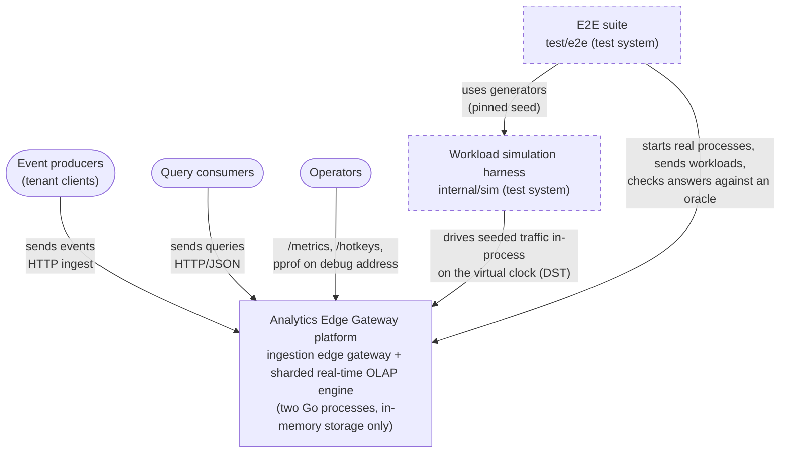

# C4 Level 1 — System Context

> **TARGET architecture — designed 2026-11-21, awaiting Nick's buy-in.**

Scope: the Analytics Edge Gateway platform (gateway + analytics engine). Model id: `01-system-context`.
Source: PLAN.md §1, §2.1, §2.8, §7.13.

## Mermaid



## Text (draw-visual)

<!-- draw-visual: diagrams/01-system-context.mmd -->
```text
┌─────────────────────────┐                ┌────────────────────────────┐
│     Event producers     ├────events─────►│Gateway + analytics platform│
└─────────────────────────┘                └────────────────────────────┘
                                                          ▲
┌─────────────────────────┐                               │
│     Query consumers     ├────────────queries────────────┤
└─────────────────────────┘                               │
                                                          │
┌─────────────────────────┐                               │
│        Operators        ├─────────metrics/pprof─────────┤
└─────────────────────────┘                               │
                                                          │
┌─────────────────────────┐                               │
│Sim harness: internal/sim├────────────seeded─────────────┤
└─────────────────────────┘                               │
             ▲                                            │
        generators                                        │
             │                                            │
┌────────────┴────────────┐                               │
│   E2E suite: test/e2e   ├───────────processes───────────┘
└─────────────────────────┘
```

## Notes

- No upstream or downstream software systems: the plan proposes in-memory storage only, with no persistence or replication (PLAN.md §9 Q7).
- Ingest and query protocols are the plan's recommendations and remain open (PLAN.md §7.13, §9 Q6/Q7).
