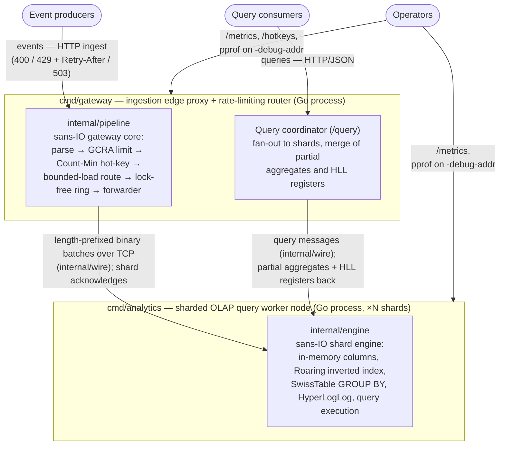

# C4 Level 2 — Container

> **TARGET architecture — designed 2026-11-21, awaiting Nick's buy-in.**

Scope: inside the Analytics Edge Gateway platform. Model id: `02-container`.
Source: PLAN.md §1, §2.4 (pprof), §2.6, §3, §4 (Chunk 8), §7.13.

Containers are the two processes. The boxes inside each are Go packages in that process, not separate deployables.

## Mermaid



## Text (draw-visual)

Data path (events and queries):

<!-- draw-visual: diagrams/02-container-data.mmd -->
```text
┌─────────────────────────────┐                ┌──────────────────────────┐
│       Event producers       │                │     Query consumers      │
└──────────────┬──────────────┘                └─────────────┬────────────┘
               │                                             │
          HTTP ingest                                    HTTP/JSON
               ▼                                             ▼
┌─────────────────────────────┐                ┌──────────────────────────┐
│  gateway: internal/pipeline │                │gateway: query coordinator│
└──────────────┬──────────────┘                └─────────────┬────────────┘
               │                                             │
          TCP batches                                        │
               ▼                                             │
┌─────────────────────────────┐                              │
│analytics xN: internal/engine│◄───────fan-out/merge─────────┘
└─────────────────────────────┘
```

Operator access:

<!-- draw-visual: diagrams/02-container-ops.mmd -->
```text
┌─────────┐                        ┌────────────────┐
│Operators├─metrics/hotkeys/pprof─►│  cmd/gateway   │
└────┬────┘                        └────────────────┘
     │
     │                             ┌────────────────┐
     └──────────metrics/pprof─────►│cmd/analytics xN│
                                   └────────────────┘
```

## Notes

- In `model.json` this view holds the two processes only, because c4-sdk does not allow components in a container view; the package boxes above are drawn in views 03 and 04 (see README, "How the model fits c4-sdk's rules").
- Hosting `/query` in the gateway is the plan's recommendation; the alternative is a coordinator role inside `cmd/analytics` (PLAN.md §9 Q6).
- Thread-per-core shape: one worker goroutine per shard ring, the only consumer of that ring and the only writer of that shard's state (PLAN.md §2.6).
- `net/http/pprof` is served on a separate `-debug-addr` listener in both processes, never on the ingest/query mux (PLAN.md §2.4).
