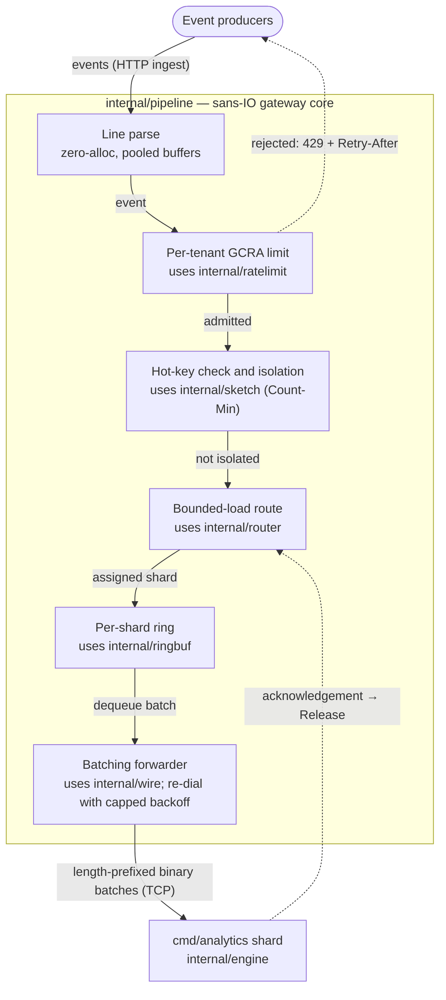

# C4 Level 3 — Component: gateway ingest pipeline (`internal/pipeline`)

> **TARGET architecture — designed 2026-11-21, awaiting Nick's buy-in.**

Scope: `internal/pipeline` inside `cmd/gateway`. Model id: `03-component-gateway-pipeline`.
Source: PLAN.md §3, §4 (Chunk 8A), §2.7, §7.3.

## Mermaid



## Text (draw-visual)

<!-- draw-visual: diagrams/03-component-gateway-pipeline.mmd -->
```text
┌──────────────────────────┐
│     Event producers      │◄──┐
└─────────────┬────────────┘   │
              │                │
           events              │
              ▼                │
┌──────────────────────────┐  429
│        Line parse        │   │
└─────────────┬────────────┘   │
              ▼                │
┌──────────────────────────┐   │
│  GCRA limit: ratelimit   ├───┘
└─────────────┬────────────┘
              │
          admitted
              ▼
┌──────────────────────────┐
│  Hot-key check: sketch   │
└─────────────┬────────────┘
              ▼
┌──────────────────────────┐
│Bounded-load route: router│◄──┐
└─────────────┬────────────┘   │
              ▼                │
┌──────────────────────────┐   │
│ Per-shard ring: ringbuf  │   │
└─────────────┬────────────┘   │
              ▼                │
┌──────────────────────────┐  ack
│ Batching forwarder: wire │   │
└─────────────┬────────────┘   │
              │                │
         TCP batches           │
              ▼                │
┌──────────────────────────┐   │
│ Analytics shard: engine  ├───┘
└──────────────────────────┘
```

## Notes

- "Load" for bounded loads is in-flight events per shard — assign on route, release on shard acknowledgement — as recommended and still open (PLAN.md §9 Q3).
- The forwarder re-dial is the only place retry is allowed (PLAN.md §2.7).
