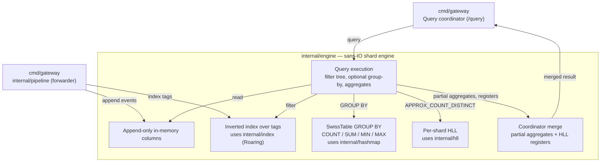

# C4 Level 3 — Component: analytics engine, query and storage (`internal/engine`)

> **TARGET architecture — designed 2026-11-21, awaiting Nick's buy-in.**

Scope: `internal/engine` inside `cmd/analytics` (the coordinator merge runs in the gateway's query coordinator). Model id: `04-component-analytics-engine`.
Source: PLAN.md §3, §4 (Chunk 8B), §7.13.

## Mermaid



## Text (draw-visual)

Ingest path:

<!-- draw-visual: diagrams/04-engine-ingest.mmd -->
```text
┌─────────────────┐         ┌─────────────────────┐
│Gateway: pipeline├─append─►│  In-memory columns  │
└────────┬────────┘         └─────────────────────┘
         │
         │                  ┌─────────────────────┐
         └───────────index─►│Inverted index: index│
                            └─────────────────────┘
```

Query round trip:

<!-- draw-visual: diagrams/04-engine-query.mmd -->
```text
┌──────────────────────────┐
│Gateway: query coordinator│◄───┐
└─────────────┬────────────┘    │
              │                 │
            query               │
              ▼                 │
┌──────────────────────────┐    │
│     Query execution      │ result
└─────────────┬────────────┘    │
              │                 │
          partials              │
              ▼                 │
┌──────────────────────────┐    │
│    Coordinator merge     ├────┘
└──────────────────────────┘
```

What query execution uses:

<!-- draw-visual: diagrams/04-engine-exec.mmd -->
```text
┌───────────────┐           ┌─────────────────────┐
│Query execution├──filter──►│Inverted index: index│
└───────┬───────┘           └─────────────────────┘
        │
        │                   ┌─────────────────────┐
        ├───────────read───►│  In-memory columns  │
        │                   └─────────────────────┘
        │
        │                   ┌─────────────────────┐
        ├─────────GROUP─BY─►│  GROUP BY: hashmap  │
        │                   └─────────────────────┘
        │
        │                   ┌─────────────────────┐
        └─────────distinct─►│  Per-shard HLL: hll │
                            └─────────────────────┘
```

## Notes

- Query and storage scope is the plan's recommendation and remains open: structured HTTP/JSON queries, in-memory storage only, no persistence, replication, or SQL text parser (PLAN.md §9 Q7).
- Document ids are `uint32`, assigned monotonically per shard (PLAN.md §7.5).
