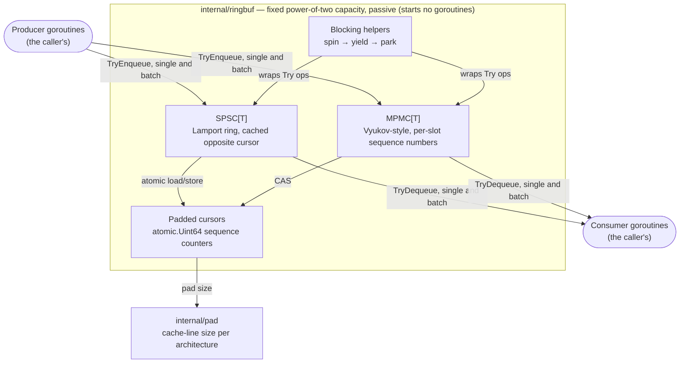

# C4 Level 3 — Component: lock-free ring buffers (`internal/ringbuf`)

> **TARGET architecture — designed 2026-11-21, awaiting Nick's buy-in.**

Scope: `internal/ringbuf`. Model id: `05-component-ringbuf`.
Source: PLAN.md §3, §4 (Chunk 1), §2.6, §7.1.

## Mermaid



## Text (draw-visual)

Callers:

<!-- draw-visual: diagrams/05-ringbuf-callers.mmd -->
```text
┌─────────┐          ┌─────────┐          ┌─────────┐
│Producers├─enqueue─►│SPSC ring├─dequeue─►│Consumers│
└────┬────┘          └─────────┘          └─────────┘
     │                                         ▲
     │               ┌─────────┐               │
     └──────enqueue─►│MPMC ring├────dequeue────┘
                     └─────────┘
```

Inside the package:

<!-- draw-visual: diagrams/05-ringbuf-internals.mmd -->
```text
┌────────────────┐
│Blocking helpers│
└────────┬───────┘
         │
         ├───────────────────┐
         │                   │
       wraps               wraps
         │                   │
         ▼                   ▼
┌────────────────┐      ┌─────────┐
│   SPSC ring    │      │MPMC ring│
└────────┬───────┘      └────┬────┘
         │                   │
      atomic                 │
         ▼                   │
┌────────────────┐           │
│ Padded cursors │◄───CAS────┘
└────────┬───────┘
         │
       size
         ▼
┌────────────────┐
│  internal/pad  │
└────────────────┘
```

## Notes

- Pad size per GOARCH (64 on amd64, 128 on arm64) is the plan's recommendation; the spec says `[64]byte` (PLAN.md §9 Q8).
