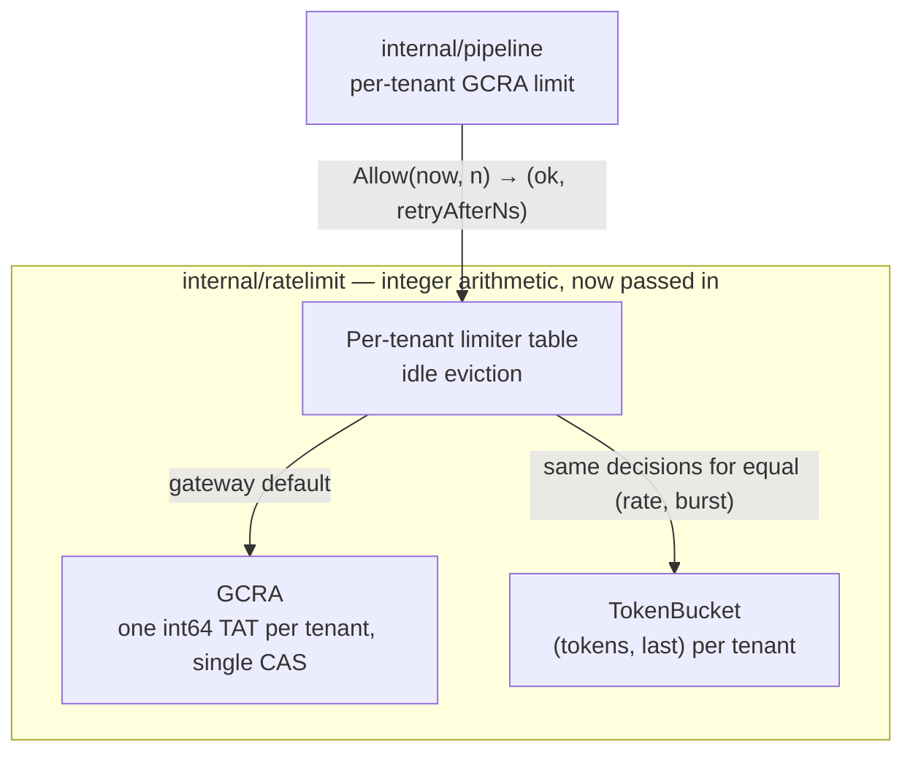

# C4 Level 3 — Component: Token Bucket / GCRA rate limiter (`internal/ratelimit`)

> **TARGET architecture — designed 2026-11-21, awaiting Nick's buy-in.**

Scope: `internal/ratelimit`. Model id: `06-component-ratelimit`.
Source: PLAN.md §3, §4 (Chunk 2), §2.7, §7.2.

## Mermaid



## Text (draw-visual)

<!-- draw-visual: diagrams/06-component-ratelimit.mmd -->
```text
┌────────────────────────┐
│  Pipeline: GCRA limit  │
└────────────┬───────────┘
             │
           Allow
             ▼
┌────────────────────────┐
│Per-tenant limiter table│
└────────────┬───────────┘
             │
             ├─────────────────────────────┐
             │                             │
          default                          │
             │                             │
             ▼                             ▼
┌────────────────────────┐    ┌─────────────────────────┐
│    GCRA: int64 TAT     │    │TokenBucket: tokens, last│
└────────────────────────┘    └─────────────────────────┘
```

## Notes

- No separate leaky-bucket-as-queue shaper is planned; GCRA is the leaky-bucket meter (PLAN.md §9 Q10).
