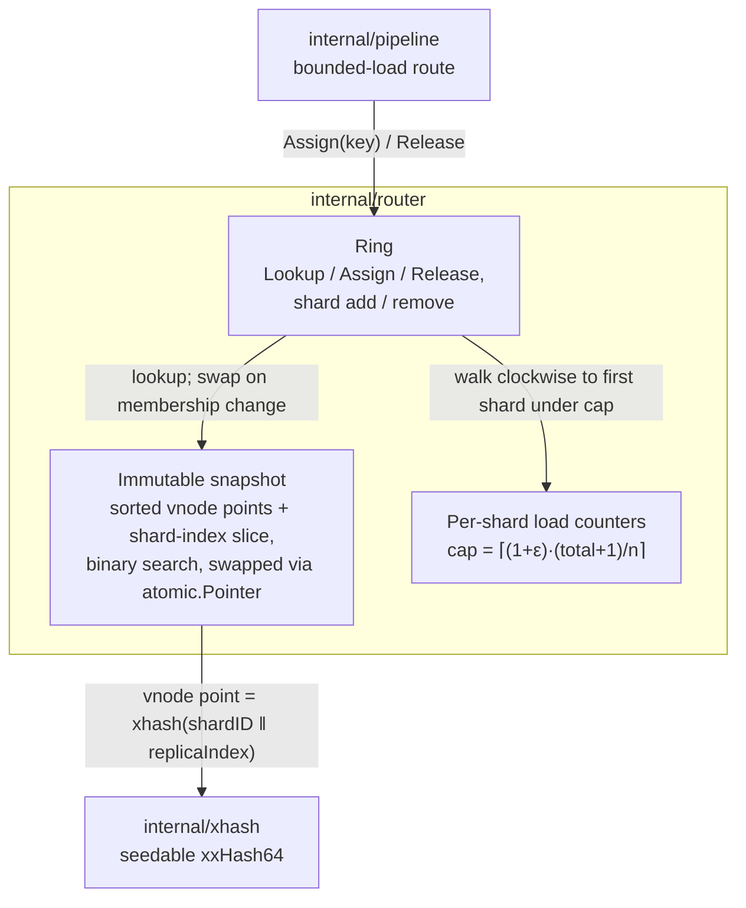

# C4 Level 3 — Component: consistent hashing with bounded loads (`internal/router`)

> **TARGET architecture — designed 2026-11-21, awaiting Nick's buy-in.**

Scope: `internal/router`. Model id: `07-component-router`.
Source: PLAN.md §3, §4 (Chunk 3), §7.3.

## Mermaid



## Text (draw-visual)

<!-- draw-visual: diagrams/07-component-router.mmd -->
```text
┌────────────────────────┐
│    Pipeline: route     │
└────────────┬───────────┘
             │
      Assign/Release
             ▼
┌────────────────────────┐
│          Ring          │
└────────────┬───────────┘
             │
             ├────────────────────────────┐
             │                            │
        lookup/swap                   under cap
             │                            │
             ▼                            ▼
┌────────────────────────┐    ┌───────────────────────┐
│Immutable vnode snapshot│    │Per-shard load counters│
└────────────┬───────────┘    └───────────────────────┘
             │
           hash
             ▼
┌────────────────────────┐
│     internal/xhash     │
└────────────────────────┘
```

## Notes

- Defaults: 160 virtual nodes per shard, ε = 0.25 (PLAN.md §7.3).
- The meaning of "load" (in-flight events per shard, recommended) is open (PLAN.md §9 Q3).
