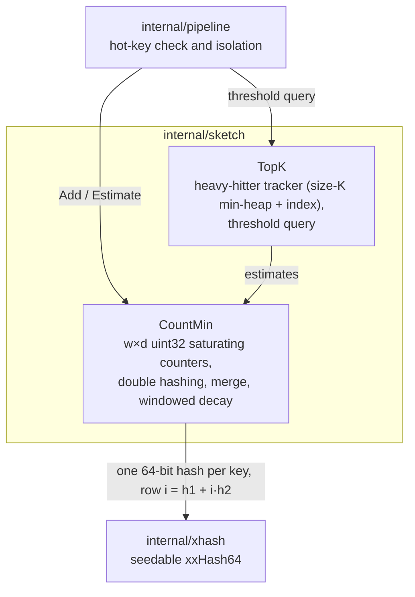

# C4 Level 3 — Component: Count-Min Sketch hot-key detection (`internal/sketch`)

> **TARGET architecture — designed 2026-11-21, awaiting Nick's buy-in.**

Scope: `internal/sketch`. Model id: `08-component-sketch`.
Source: PLAN.md §3, §4 (Chunk 4), §7.4.

## Mermaid



## Text (draw-visual)

<!-- draw-visual: diagrams/08-component-sketch.mmd -->
```text
┌────────────────────────┐
│Pipeline: hot-key check ├──────threshold───────┐
└────────────┬───────────┘                      │
             │                                  │
       Add/Estimate                             │
             ▼                                  ▼
┌────────────────────────┐            ┌──────────────────┐
│CountMin: w x d counters│◄estimates──┤TopK heavy hitters│
└────────────┬───────────┘            └──────────────────┘
             │
           hash
             ▼
┌────────────────────────┐
│     internal/xhash     │
└────────────────────────┘
```

## Notes

- Defaults: w = 4096, d = 4 (64 KiB); counters are halved at each window boundary on the virtual clock (PLAN.md §7.4).
