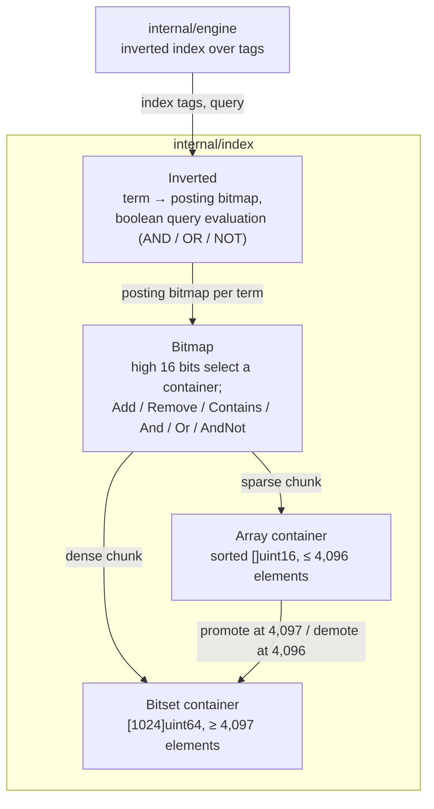

# C4 Level 3 — Component: inverted index + Roaring bitmaps (`internal/index`)

> **TARGET architecture — designed 2026-11-21, awaiting Nick's buy-in.**

Scope: `internal/index`. Model id: `09-component-index`.
Source: PLAN.md §3, §4 (Chunk 5), §7.5.

## Mermaid



## Text (draw-visual)

<!-- draw-visual: diagrams/09-component-index.mmd -->
```text
┌────────────────────────┐
│   Engine: tag index    │
└────────────┬───────────┘
             ▼
┌────────────────────────┐
│Inverted: term to bitmap│
└────────────┬───────────┘
             ▼
┌────────────────────────┐
│ Bitmap: 16-bit chunks  ├──────────dense───────────┐
└────────────┬───────────┘                          │
             │                                      │
          sparse                                    │
             ▼                                      ▼
┌────────────────────────┐                 ┌────────────────┐
│    Array container     ├─promote/demote─►│Bitset container│
└────────────────────────┘                 └────────────────┘
```

## Notes

- Run containers and serialisation are not planned (PLAN.md §7.5, §8).
