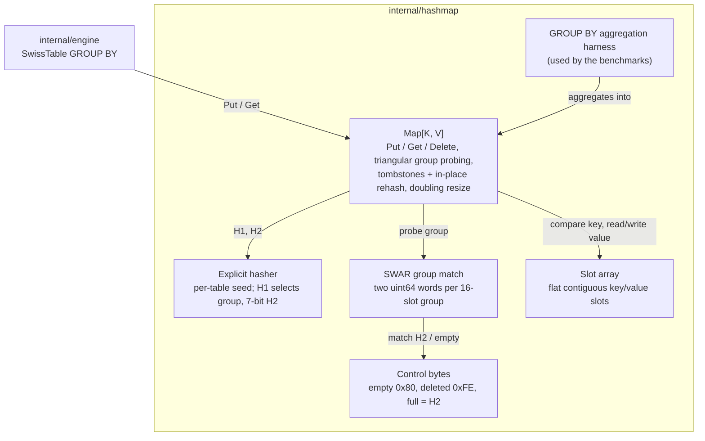

# C4 Level 3 — Component: SwissTable hash map (`internal/hashmap`)

> **TARGET architecture — designed 2026-11-21, awaiting Nick's buy-in.**

Scope: `internal/hashmap`. Model id: `10-component-hashmap`.
Source: PLAN.md §3, §4 (Chunk 6), §7.6.

## Mermaid



## Text (draw-visual)

<!-- draw-visual: diagrams/10-component-hashmap.mmd -->
```text
┌────────────────┐    ┌───────────────────┐
│Engine: GROUP BY│    │Aggregation harness│
└────────┬───────┘    └─────────┬─────────┘
         │                      │
      Put/Get                   │
         ▼                      │
┌────────────────┐              │
│    Map K,V     │◄─────────────┘
└────────┬───────┘
         │
         ├──────────────────────┬────────────────────┐
         │                      │                    │
       probe                  H1/H2              key/value
         │                      │                    │
         ▼                      ▼                    ▼
┌────────────────┐    ┌───────────────────┐    ┌──────────┐
│SWAR group match│    │  Explicit hasher  │    │Slot array│
└────────┬───────┘    └───────────────────┘    └──────────┘
         │
       match
         ▼
┌────────────────┐
│ Control bytes  │
└────────────────┘
```

## Notes

- Max load 7/8; pure Go, no assembly, no `unsafe` (PLAN.md §3, §7.6).
