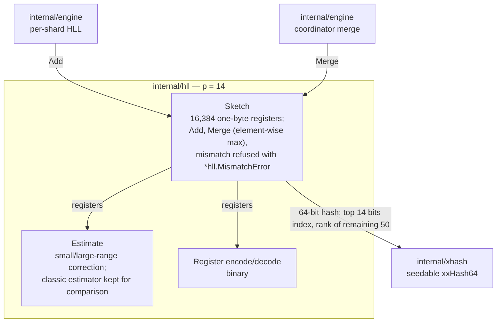

# C4 Level 3 — Component: HyperLogLog (`internal/hll`)

> **TARGET architecture — designed 2026-11-21, awaiting Nick's buy-in.**

Scope: `internal/hll`. Model id: `11-component-hll`.
Source: PLAN.md §3, §4 (Chunk 7), §7.7.

## Mermaid



## Text (draw-visual)

<!-- draw-visual: diagrams/11-component-hll.mmd -->
```text
┌───────────────────────┐        ┌─────────────────────────┐
│ Engine: per-shard HLL │        │Engine: coordinator merge│
└───────────┬───────────┘        └────────────┬────────────┘
            │                                 │
           Add                                │
            ▼                                 │
┌───────────────────────┐                     │
│Sketch: 16384 registers│◄───────Merge────────┘
└───────────┬───────────┘
            │
            ├─────────────────────────────────┬─────────────────────────┐
            │                                 │                         │
            │                                 │                       hash
            │                                 │                         │
            ▼                                 ▼                         ▼
┌───────────────────────┐        ┌─────────────────────────┐    ┌──────────────┐
│        Estimate       │        │      Register codec     │    │internal/xhash│
└───────────────────────┘        └─────────────────────────┘    └──────────────┘
```

## Notes

- Primary estimator (Ertl's improved estimator, recommended) is open (PLAN.md §9 Q11).
- No sparse representation is planned (PLAN.md §7.7).
